<div align="center" dir="rtl">

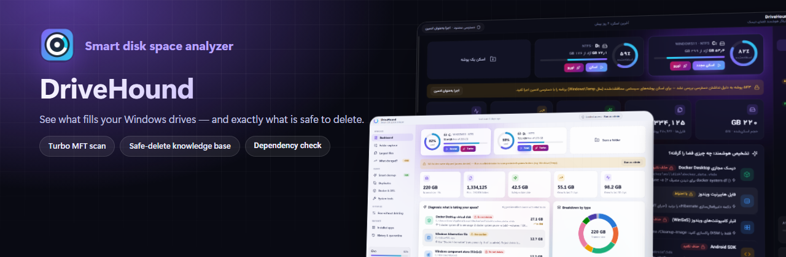

# DriveHound

**تحلیلگر هوشمند فضای دیسک برای ویندوز**

پیدا می‌کند چه چیزی درایو شما را پر کرده، توضیح می‌دهد هر فایل و پوشه چیست،
و می‌گوید حذفش امن است یا نه — بدون اینکه ویندوز، برنامه‌ها یا پروژه‌هایتان خراب شوند.

[English](README.en.md) · [دانلود](#-دانلود-و-نصب) · [راهنمای استفاده](#-راهنمای-استفاده) · [ساخت از سورس](#-ساخت-از-سورس-برای-توسعه‌دهنده‌ها) · [امنیت](#-امنیت-و-حریم-خصوصی)

[](https://github.com/MohamadTahernezhad/DriveHound/actions/workflows/ci.yml)
[](https://github.com/MohamadTahernezhad/DriveHound/releases/latest)
[](https://github.com/MohamadTahernezhad/DriveHound/releases)


<a href="https://github.com/MohamadTahernezhad/DriveHound/releases/latest"></a>

</div>

<div dir="rtl">

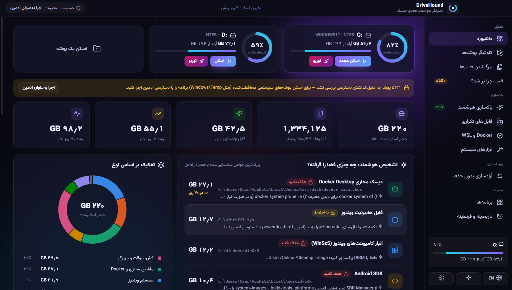

## ✨ چرا DriveHound؟

ابزارهای معمولی فقط می‌گویند «این پوشه ۲۷ گیگ است». DriveHound می‌گوید:

> **دیسک مجازی Docker Desktop — حذف نکنید.** تمام کانتینرها و دیتابیس‌ها داخل این فایل است و در ۷ روز اخیر ۲۷ گیگ بزرگ شده.
> روش درست: `docker system prune -a` و سپس فشرده‌سازی دیسک مجازی — هر دو با یک کلیک.

## 🧩 امکانات

| بخش | کاری که انجام می‌دهد |
|---|---|
| **اسکن سریع** | اسکن چندرشته‌ای (حدود ۲۵ هزار فایل در ثانیه) یا **حالت توربو** که جدول MFT درایو را مستقیم می‌خواند (درایو C در چند ثانیه؛ نیاز به دسترسی ادمین) |
| **پایگاه دانش** | ۱۰۰ قانون با صدها الگوی مسیر: کش‌ها، Temp، Docker، WSL، شبیه‌ساز اندروید، Gradle، npm، مرورگرها، IDEها، فایل‌های سیستمی و … با چهار سطح «امن / با احتیاط / شخصی / حذف نکنید» |
| **بررسی وابستگی** | قبل از حذف بررسی می‌کند: برنامه در حال اجرا، سرویس ویندوز، اجرای خودکار، PATH، برنامه نصب‌شده صاحب فایل، پروژه برنامه‌نویسی، قفل بودن فایل |
| **چرا پر شد؟** | پوشه‌هایی که در ۷ یا ۳۰ روز اخیر بزرگ شده‌اند، فایل‌های حجیم جدید و مقایسه دقیق با اسکن قبلی |
| **پاکسازی هوشمند** | دسته‌بندی موارد امن، نیازمند ابزار، با احتیاط و شخصی + ابزارهای ویندوز (DISM، Disk Cleanup، Hibernate، سطل بازیافت) |
| **فایل‌های تکراری** | تشخیص با هش SHA-256؛ حذف نسخه‌های اضافه یا تبدیل به هاردلینک |
| **Docker و WSL** | ایمیج‌ها، کانتینرها، والیوم‌ها و کش بیلد با حجم دقیق؛ فشرده‌سازی دیسک مجازی |
| **ابزارهای سیستم** | درایورهای قدیمی، نقاط بازگردانی، CompactOS، فایل Hibernate |
| **آزادسازی بدون حذف** | انتقال پوشه‌های حجیم به درایو دیگر با Junction (برنامه‌ها چیزی متوجه نمی‌شوند) و فشرده‌سازی شفاف NTFS — همه قابل برگشت |
| **دستیار هوش مصنوعی** | توضیح فایل‌های ناشناخته با **هر مدلی**: Claude، OpenAI، Gemini، OpenRouter، Groq، DeepSeek، Mistral یا مدل محلی (Ollama، LM Studio) |
| **قرنطینه و تاریخچه** | حذف به قرنطینه روی درایو دیگر (قابل بازگشت تا N روز) و ثبت همه عملیات |
| **پایش خودکار** | نمودار فضای آزاد، اعلان پر شدن ناگهانی درایو همراه با علت، گزارش هفتگی |
| **فیلترهای پیشرفته** | در همه لیست‌ها: انتخاب چندگانه، محدوده حجم و تاریخ، مرتب‌سازی، ذخیره فیلتر و جستجوی پیشرفته |
| **سایر** | منوی راست‌کلیک Explorer، گزارش HTML/PDF، خروجی CSV، قوانین شخصی، مسیرهای محافظت‌شده، تم تیره/روشن |

## 🖼 تصاویر

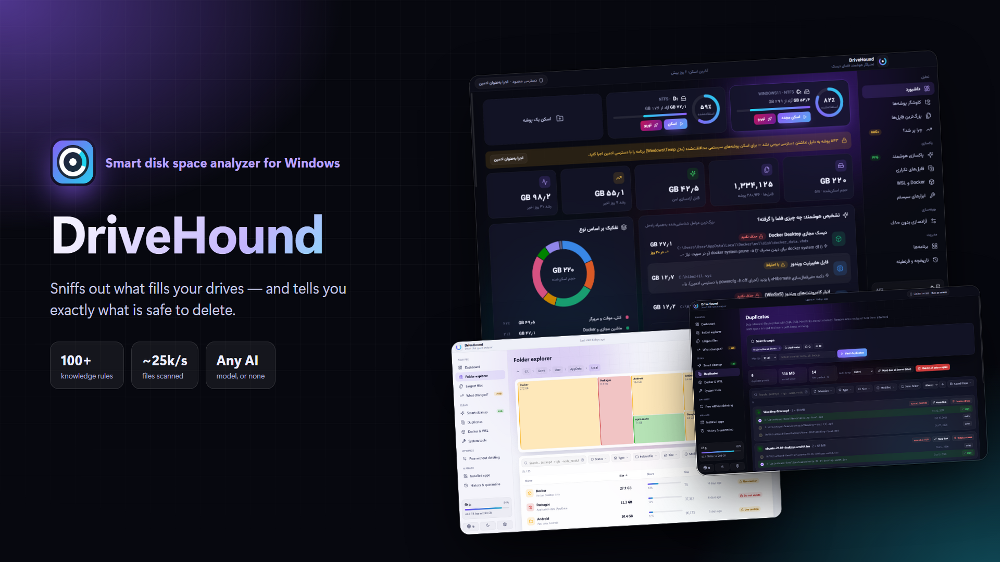

| | |
|---|---|
| 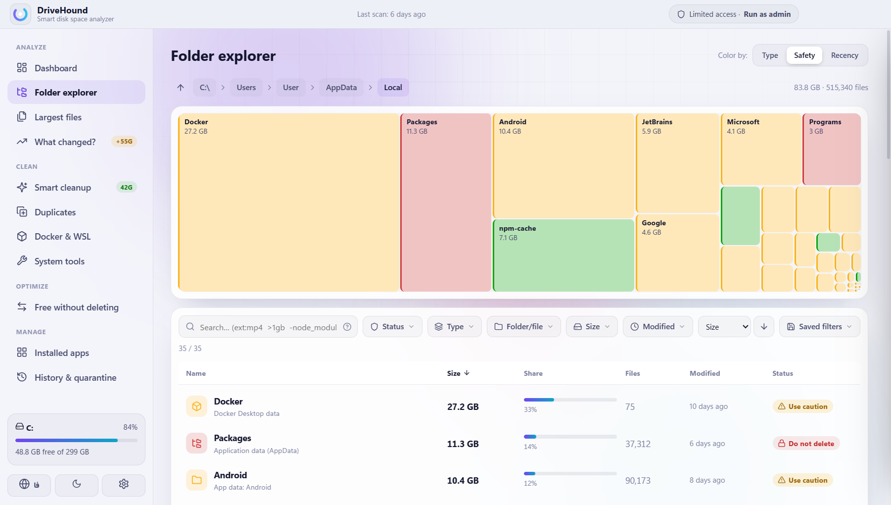 | 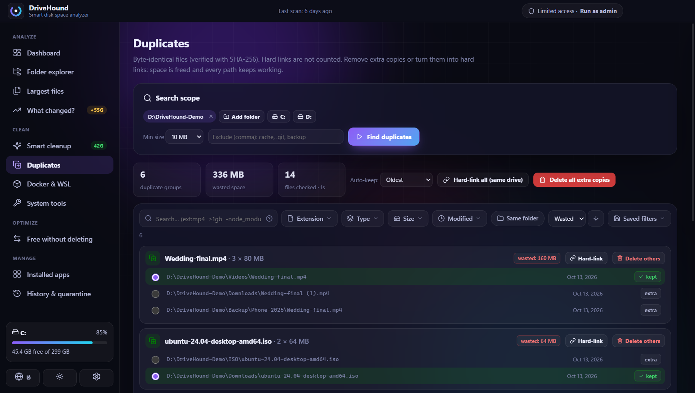 |
| 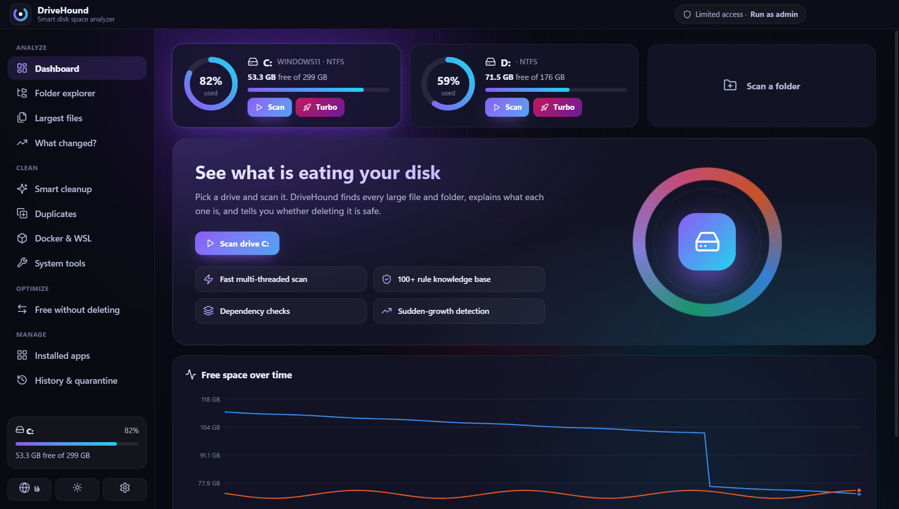 | 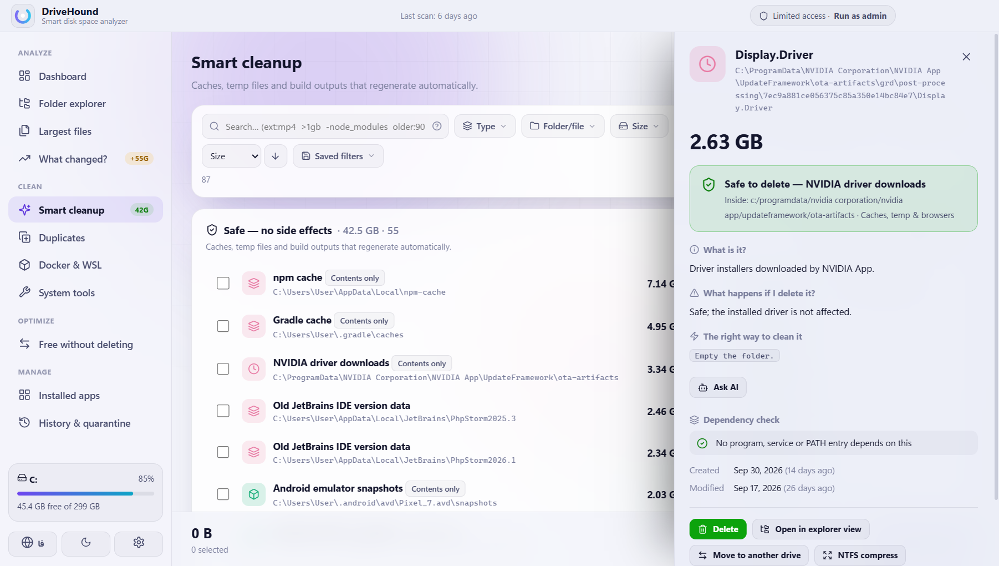 |
| 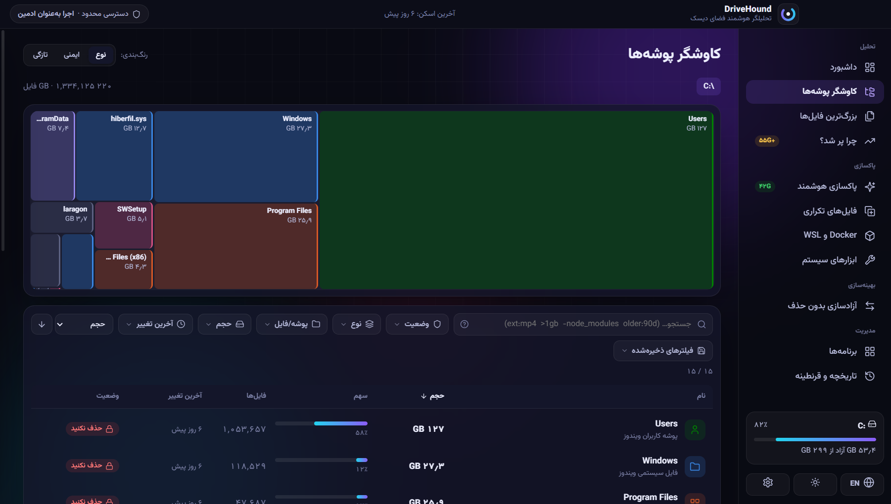 | 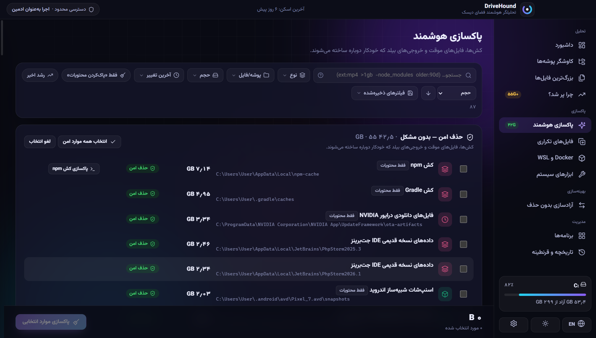 |
| 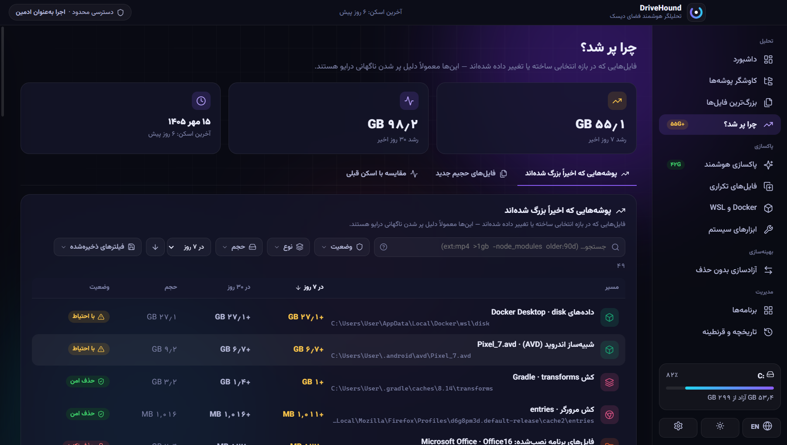 | 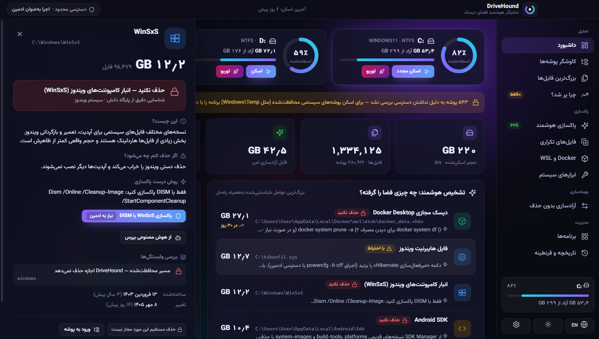 |
| 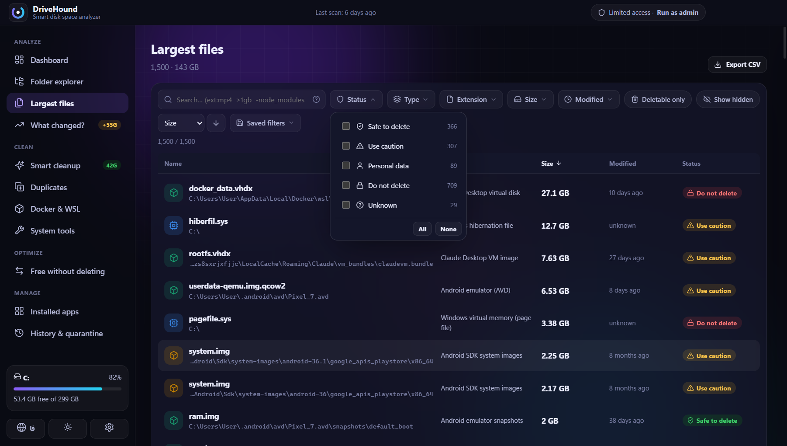 | 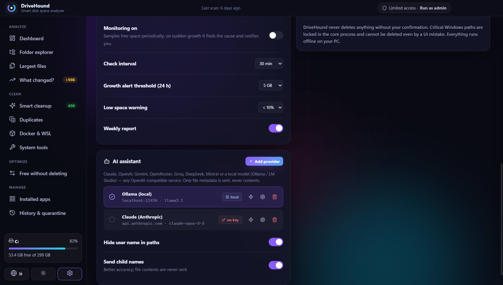 |
| 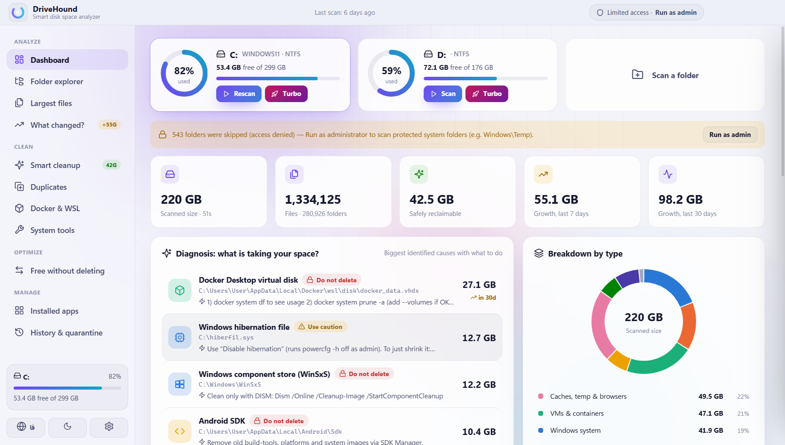 | 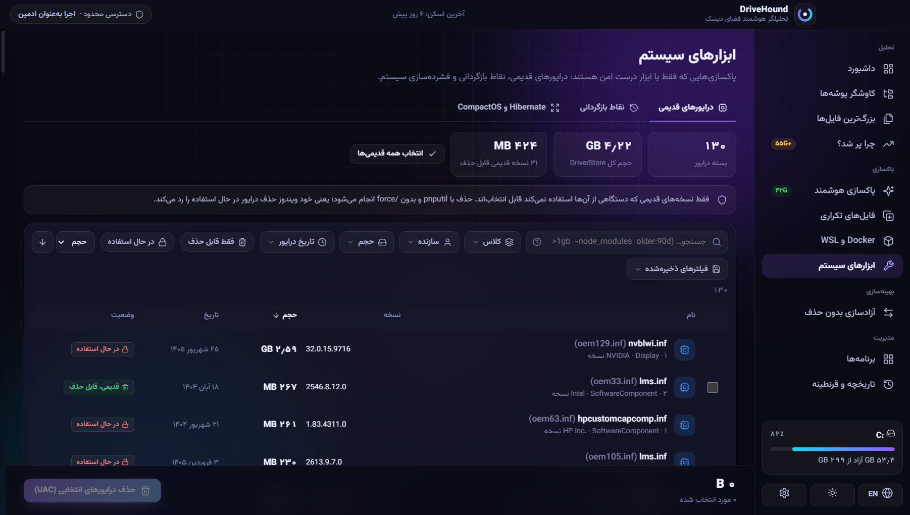 |

---

## 📥 دانلود و نصب

### پیش‌نیاز
- ویندوز ۱۰ یا ۱۱ (۶۴ بیتی)
- حدود ۳۰۰ مگابایت فضای خالی

### روش ۱ — نسخه نصبی (پیشنهادی)
1. به صفحه **[Releases](../../releases/latest)** بروید.
2. فایل `DriveHound-Setup-x.y.z.exe` را دانلود کنید.
3. اجرا کنید، مسیر نصب را انتخاب کنید و **Install** را بزنید.
4. از منوی استارت یا میانبر دسکتاپ «DriveHound» را باز کنید.

### روش ۲ — نسخه قابل‌حمل (بدون نصب)
فایل `DriveHound-Portable-x.y.z.exe` را دانلود و مستقیم اجرا کنید. مناسب فلش یا وقتی نمی‌خواهید چیزی نصب شود.

### هشدار SmartScreen
چون فایل‌ها امضای دیجیتال تجاری ندارند، ویندوز ممکن است بار اول هشدار «Windows protected your PC» نشان دهد:
**More info** ← **Run anyway**. کد کامل برنامه در همین مخزن قابل بررسی است.

### حذف برنامه
از **Settings ← Apps ← DriveHound ← Uninstall**. حذف‌کننده، منوی راست‌کلیک و اجرای خودکار را هم پاک می‌کند.
تنظیمات و تاریخچه در `%APPDATA%\DriveHound` می‌ماند؛ برای پاک‌سازی کامل آن پوشه را هم حذف کنید.

---

## 📖 راهنمای استفاده

### اولین اسکن
1. در **داشبورد** روی کارت درایو، دکمه **اسکن** را بزنید (درایو C حدود یک دقیقه).
2. برای اسکن کامل‌تر و بسیار سریع‌تر، **توربو** را بزنید و اجازه ادمین (UAC) بدهید.
3. برای دیدن پوشه‌های محافظت‌شده سیستم، از بالای برنامه **اجرا به‌عنوان ادمین** را بزنید.

### فهمیدن اینکه یک فایل چیست
روی هر مورد کلیک کنید. پنل جزئیات نشان می‌دهد:
- **این چیست؟**، **اگر حذف کنم چه می‌شود؟** و **روش درست پاکسازی** (اغلب با دکمه اجرای مستقیم)
- **بررسی وابستگی‌ها**: آیا برنامه‌ای در حال استفاده از آن است، متعلق به چه برنامه یا پروژه‌ای است
- اگر در پایگاه دانش نبود: **از هوش مصنوعی بپرس**

### معنی رنگ‌ها
| برچسب | معنی |
|---|---|
| 🟢 **حذف امن** | خودکار دوباره ساخته می‌شود (کش، Temp، خروجی بیلد) |
| 🟡 **با احتیاط** | قابل حذف ولی با پیامد (دانلود مجدد، از دست رفتن تنظیمات) |
| 🔵 **فایل شخصی** | فقط خودتان می‌دانید لازم است یا نه |
| 🔴 **حذف نکنید** | ویندوز یا برنامه خراب می‌شود؛ برنامه ابزار درست را پیشنهاد می‌دهد |

### روش‌های حذف
- **سطل بازیافت** (پیش‌فرض): قابل برگشت، ولی فضا تا خالی کردن سطل آزاد نمی‌شود.
- **قرنطینه**: روی درایو دیگری منتقل می‌شود، فضا فوراً آزاد می‌شود و تا چند روز قابل بازگشت است (تنظیمات ← درایو قرنطینه).
- **حذف دائمی**: فوری و غیرقابل بازگشت — برای کش‌ها مناسب است.

### جستجوی پیشرفته در فیلترها
| نوشتن | یعنی |
|---|---|
| `ext:mp4,mkv` | فقط این پسوندها |
| `>1gb` / `<500mb` | بزرگ‌تر / کوچک‌تر از |
| `-node_modules` | مسیرهایی که این کلمه را ندارند |
| `"exact phrase"` | عبارت دقیق |
| `newer:7d` / `older:1y` | تغییر در ۷ روز اخیر / قدیمی‌تر از یک سال |
| `is:safe` | فقط موارد امن (`caution`, `user`, `danger`) |

فیلترهای پرکاربرد را با **فیلترهای ذخیره‌شده** نگه دارید. `Ctrl+F` جستجو را فعال می‌کند.

### آزادسازی بدون حذف (انتقال به درایو دیگر)
در **آزادسازی بدون حذف** پوشه‌هایی مثل شبیه‌ساز اندروید، Gradle، کش npm/pip یا هر پوشه دلخواه را به درایو D منتقل کنید.
برنامه پوشه را کپی و صحت آن را بررسی می‌کند و یک Junction به جای قبلی می‌گذارد؛ هر انتقال با یک کلیک برگشت‌پذیر است.
اگر برنامه‌ای از پوشه استفاده کند، انتقال اصلاً شروع نمی‌شود.

### دستیار هوش مصنوعی
**تنظیمات ← دستیار هوش مصنوعی ← افزودن سرویس**، یک الگو انتخاب کنید:

| سرویس | آدرس API | کلید |
|---|---|---|
| Claude (Anthropic) | خودکار | `sk-ant-…` از console.anthropic.com |
| OpenAI | `https://api.openai.com/v1` | از platform.openai.com |
| Google Gemini | `https://generativelanguage.googleapis.com/v1beta/openai` | از aistudio.google.com |
| OpenRouter | `https://openrouter.ai/api/v1` | از openrouter.ai |
| Groq / DeepSeek / Mistral | آماده در لیست | از سایت هر سرویس |
| **Ollama (محلی، رایگان)** | `http://localhost:11434/v1` | لازم نیست |
| **LM Studio (محلی، رایگان)** | `http://localhost:1234/v1` | لازم نیست |
| هر سرویس سازگار با OpenAI | آدرس دلخواه (https) | در صورت نیاز |

نام مدل را طبق مستندات سرویس وارد کنید و **ذخیره و تست اتصال** را بزنید. چند سرویس می‌توانید داشته باشید و یکی را فعال کنید.
قبل از اولین ارسال، **دقیقاً همان داده‌ای که ارسال می‌شود** نشان داده می‌شود؛ محتوای هیچ فایلی ارسال نمی‌شود.

### پایش خودکار
با بستن پنجره، برنامه کنار ساعت ویندوز می‌ماند و هر ۳۰ دقیقه فضای آزاد را ثبت می‌کند. اگر درایو در ۲۴ ساعت بیش از ۵ گیگ پر شود،
خودش اسکن می‌کند و با اعلان می‌گوید چه چیزی بزرگ شده. همه این مقادیر در تنظیمات قابل تغییرند.

---

## 🔒 امنیت و حریم خصوصی

- **هیچ چیزی بدون تأیید شما حذف نمی‌شود.** پیش‌فرض سطل بازیافت است و همه عملیات در تاریخچه ثبت می‌شوند.
- **لایه محافظت در هسته برنامه:** ریشه درایوها، پوشه Windows (به جز Temp و لاگ‌ها)، Program Files، ریشه پروفایل کاربر و فایل‌های سیستمی هرگز حذف نمی‌شوند؛ حتی اگر رابط کاربری اشتباه کند. ترفندهایی مثل `..`، نام‌های کوتاه `PROGRA~1`، Junction و `\\?\` هم بی‌اثرند.
- **مسیرهای محافظت‌شده شخصی** که خودتان تعریف می‌کنید هم در هسته اعمال می‌شوند.
- **رابط کاربری کاملاً ایزوله است:** به سیستم و اینترنت دسترسی ندارد و فقط شناسه عملیات را می‌فرستد، نه دستور.
- **همه چیز آفلاین است.** فقط وقتی خودتان از هوش مصنوعی سؤال کنید، مشخصات همان یک مورد به سرویس انتخابی شما ارسال می‌شود. با مدل محلی (Ollama) هیچ داده‌ای از کامپیوتر خارج نمی‌شود.
- **کلیدهای API** با رمزنگاری خود ویندوز (DPAPI) ذخیره می‌شوند و هرگز به رابط کاربری برنمی‌گردند.

جزئیات بیشتر: [SECURITY.md](SECURITY.md)

---

## 🛠 ساخت از سورس (برای توسعه‌دهنده‌ها)

### پیش‌نیازها
- ویندوز ۱۰/۱۱ ۶۴ بیتی
- [Node.js](https://nodejs.org) نسخه **۲۲ یا جدیدتر**
- Git
- ‎.NET Framework 4.x (روی همه ویندوزها از قبل نصب است؛ برای کامپایل ماژول توربو با `csc.exe` داخلی ویندوز)

### اجرا در حالت توسعه
```bash
git clone https://github.com/MohamadTahernezhad/DriveHound.git
cd DriveHound
npm install
npm run build:native      # ساخت ماژول توربو (native/mftscan.exe)
npm start
```
> اگر از ترمینال VS Code اجرا می‌کنید و برنامه باز نشد، متغیر `ELECTRON_RUN_AS_NODE` را پاک کنید
> (PowerShell: `Remove-Item Env:ELECTRON_RUN_AS_NODE`).

### تست‌ها
```bash
npm test             # تست‌های واحد و یکپارچه (هسته، امنیت، فایل‌ها، هوش مصنوعی)
npm run test:e2e     # تست رابط کاربری و امنیت داخل خود برنامه (پروفایل جداگانه، به داده‌های شما دست نمی‌زند)
npm run audit        # بررسی آسیب‌پذیری وابستگی‌ها
```

### اسکرین‌شات‌ها
بعد از یک بار اسکن درایو C: در برنامه:
```bash
npm run screenshots  # عکس‌های docs/screenshots از داخل خود برنامه، با نسخه‌ی ناشناس اسکن شما
npm run showcase     # docs/showcase.png
npm run banner       # docs/banner.png و docs/social-preview.png
```

### ساخت فایل نصبی
```bash
npm run dist
```
خروجی در پوشه `release/`:
- `DriveHound-Setup-x.y.z.exe` — نصب‌کننده
- `DriveHound-Portable-x.y.z.exe` — نسخه قابل‌حمل

### نصب روی سیستم خودتان از سورس
بعد از `npm run dist` فایل `release/DriveHound-Setup-x.y.z.exe` را اجرا کنید؛ مثل هر برنامه دیگری نصب می‌شود.

### اسکریپت‌های آماده (یک دستور)
در PowerShell با `powershell -ExecutionPolicy Bypass -File …` اجرا کنید:

| اسکریپت | کار |
|---|---|
| `scripts\setup-dev.ps1` | بررسی Node و ‎.NET، نصب پکیج‌ها، ساخت ماژول توربو و اجرای تست‌ها (با `-Start` برنامه را هم باز می‌کند) |
| `scripts\build-installer.ps1` | ساخت کامل فایل نصبی و نسخه‌ی قابل‌حمل به‌همراه چک‌سام SHA-256 (با `-Install` نصب را هم شروع می‌کند) |
| `scripts\publish-github.ps1` | تنظیم لینک‌ها روی مخزن شما، commit و push، و با `-Release` ساخت خودکار Release در GitHub |

راهنمای قدم‌به‌قدم انتشار در GitHub: [docs/GITHUB-GUIDE-FA.md](docs/GITHUB-GUIDE-FA.md)

### انتشار نسخه جدید در GitHub
مخزن یک GitHub Action دارد که با هر تگ نسخه، تست‌ها را اجرا و فایل‌های نصبی را می‌سازد و به Release پیوست می‌کند:
```bash
# نسخه را در package.json به‌روز کنید، سپس:
git tag v2.1.1
git push origin v2.1.1
```

### فعال‌سازی به‌روزرسانی خودکار
دستور `node scripts/set-repo.js <نام-کاربری-گیت‌هاب>` بخش `build.publish` و لینک‌های مخزن را به `package.json` اضافه می‌کند. نسخه‌هایی که بعد از آن ساخته شوند، خودشان از Releases مخزن شما به‌روز می‌شوند. اسکریپت `publish-github.ps1` این کار را خودکار انجام می‌دهد.
برای حذف هشدار SmartScreen یک گواهی امضای کد تهیه کنید و متغیرهای `CSC_LINK` و `CSC_KEY_PASSWORD` را هنگام ساخت تنظیم کنید.

### ساختار پروژه
```
main.js              فرایند اصلی Electron: IPC امن، پروتکل app://، Tray، پایش
preload.js           تنها پل بین رابط کاربری و هسته
core/                منطق اصلی: guard (محافظت مسیرها)، حذف، قرنطینه، انتقال، Docker/WSL،
                     ابزارهای سیستم، هوش مصنوعی، پایش، اعتبارسنجی ورودی‌ها
scanner/             Worker اسکن (پیمایش یا MFT) و یافتن تکراری‌ها
native/MftScan.cs    خواننده فقط‌خواندنی جدول MFT (C#)
shared/              پایگاه دانش و مقایسه اسکن‌ها
renderer/            رابط کاربری (HTML/CSS/JS بدون فریم‌ورک)
tests/               تست‌های واحد، یکپارچه و e2e
scripts/             ساخت ماژول توربو و پروفایل نمایشی برای اسکرین‌شات
```

---

## ❓ سؤالات متداول و عیب‌یابی

<details><summary><b>چرا عدد «اسکن‌شده» با فضای استفاده‌شده ویندوز فرق دارد؟</b></summary>

بدون دسترسی ادمین چند پوشه سیستمی خوانده نمی‌شوند (مثل System Volume Information). با **توربو** یا **اجرا به‌عنوان ادمین** همه چیز شمرده می‌شود. هاردلینک‌ها (مثل WinSxS) فقط یک‌بار حساب می‌شوند.
</details>

<details><summary><b>حذف کردم ولی فضا آزاد نشد.</b></summary>

اگر روش حذف «سطل بازیافت» بود، سطل را خالی کنید (پاکسازی هوشمند ← ابزارهای سیستمی). برای دیسک‌های مجازی Docker/WSL بعد از پاکسازی داخلشان، «فشرده‌سازی» را بزنید.
</details>

<details><summary><b>توربو کار نمی‌کند.</b></summary>

توربو فقط روی درایوهای NTFS و با اجازه ادمین کار می‌کند. اگر UAC را رد کنید، برنامه خودکار اسکن معمولی انجام می‌دهد.
</details>

<details><summary><b>هوش مصنوعی خطای اتصال می‌دهد.</b></summary>

آدرس API و نام مدل را با مستندات سرویس مقایسه کنید و «تست اتصال» را بزنید. برای Ollama/LM Studio مطمئن شوید سرور محلی در حال اجراست. آدرس‌های غیرمحلی باید `https` باشند.
</details>

<details><summary><b>فایل لاگ کجاست؟</b></summary>

`%APPDATA%\DriveHound\data\logs\main.log` — فقط خطاها؛ بدون محتوای فایل و بدون کلید.
</details>

---

## 🤝 مشارکت
گزارش باگ و پیشنهاد در بخش [Issues](../../issues). برای ارسال کد [CONTRIBUTING.md](CONTRIBUTING.md) را بخوانید. تغییرات هر نسخه در [CHANGELOG.md](CHANGELOG.md).

## 📄 مجوز
[MIT](LICENSE) — استفاده، تغییر و انتشار آزاد.

</div>
